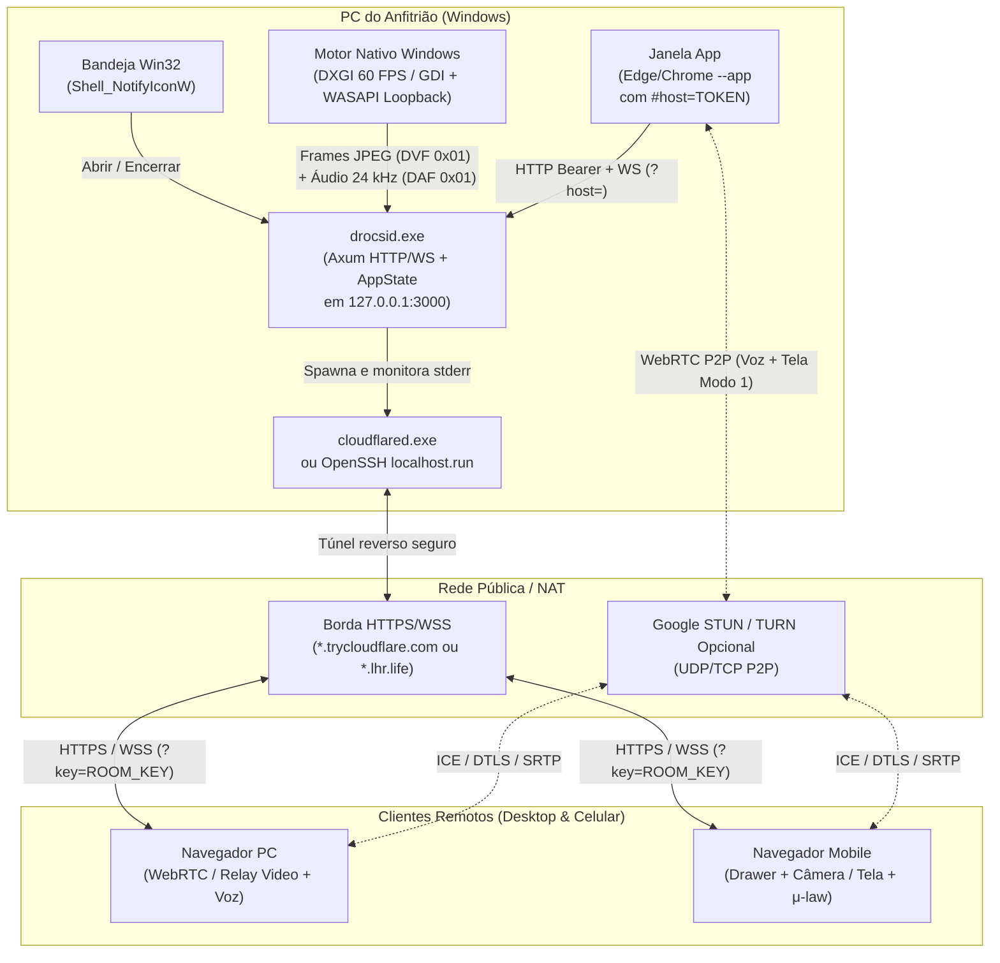
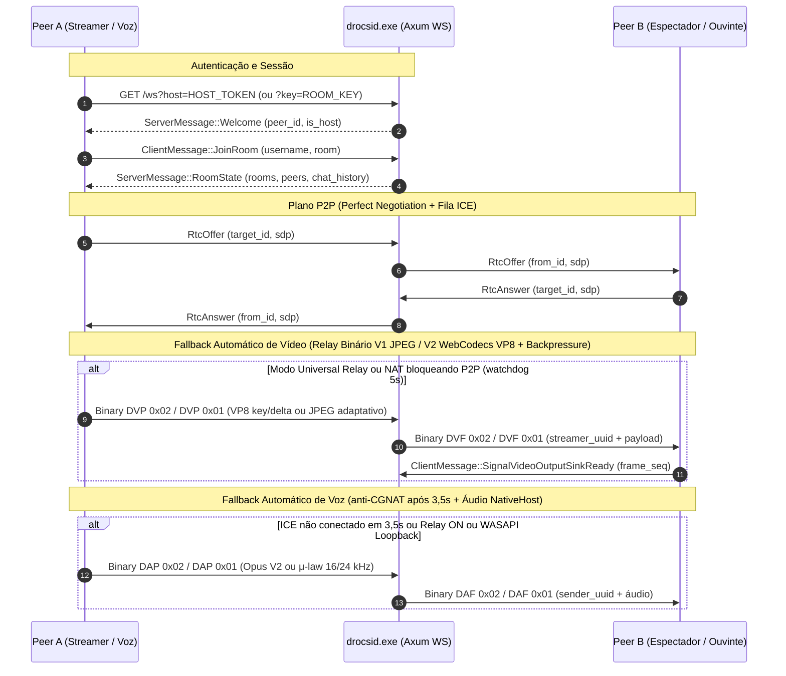
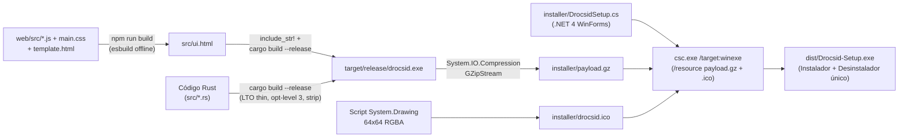

# Arquitetura e Processo de Construção do Drocsid (`v0.4.0`)

O **Drocsid** é uma plataforma auto-hospedada e leve para comunicação por voz, texto, webcam e compartilhamento de tela (*Go Live*), escrita em **Rust** com interface modular (`web/`) compilada em HTML/CSS/JS único embarcado no executável nativo para Windows e sem dependência de servidores centrais proprietários.

> [!NOTE]
> Este documento reflete a base de código implementada em `v0.4.0` (incluindo UI modular empacotada offline com `esbuild`, áudio Opus/RNNoise/`AudioWorklet`, vídeo WebCodecs VP8 + `createImageBitmap`, captura nativa DXGI 60 FPS + WASAPI Loopback, upload de mídia e moderação avançada de salas), com links diretos para os arquivos do repositório. Para diretrizes de colaboração de agentes de IA (autorização prévia, não regressão e sincronização de `todo`, `ARCHITECTURE.md` e `README.md`), veja [`AGENTS.md`](AGENTS.md).

---

## 1. Origem e Premissa Arquitetural (Engenharia Reversa com REA)

A arquitetura do Drocsid nasceu da análise estática de engenharia reversa (**REA**, `morluto/rea`) sobre o cliente desktop do Discord (`app-1.0.9267`), espelhando em Rust + Web APIs os principais mecanismos encontrados no módulo nativo e no bundle Electron ([`src/capture.rs`](src/capture.rs), [`README.md`](README.md)):

| Mecanismo Original (Discord `app-1.0.9267`) | Referência REA Observada | Equivalente no Drocsid |
|---|---|---|
| Listagem e miniaturas de monitores/janelas | `GetScreenPreviews` (ordinal `121` em `discord_voice.node`) e `getDesktopCaptureSources` (módulo webpack `9425` em `core.asar`) | `get_screen_previews()` + `GET /api/screens` ([`src/capture.rs`](src/capture.rs)) |
| Seleção da fonte de captura nativa | `SetDesktopSource` (ordinal `165`) / `SetGoLiveDevices` (ordinal `175`) | `ClientMessage::StartScreenShare` + `capture_source_jpeg_bytes` ([`src/protocol.rs`](src/protocol.rs)) |
| Sincronização de renderização (*backpressure*) | `SetVideoOutputSink` (`231`) e `SignalVideoOutputSinkReady` (`237`) | `SignalVideoOutputSinkReady` + janela deslizante `MAX_FRAMES_IN_FLIGHT = 2` ([`src/state.rs`](src/state.rs)) |

Diferente do Electron com múltiplas bibliotecas, o Drocsid concentra tudo em **um binário Rust único** (`drocsid.exe`) que atua simultaneamente como servidor HTTP/WebSocket local, servidor de sinalização WebRTC, relay binário anti-CGNAT, motor nativo DXGI/GDI + captura WASAPI Loopback e orquestrador de túnel público.

---

## 2. Topologia e Visão Geral do Sistema

Abaixo está a topologia de execução em tempo real quando o anfitrião (*Host*) abre o aplicativo e compartilha uma sala com amigos em outras redes (PC ou celular):

### Pilha Tecnológica ([`Cargo.toml`](Cargo.toml))

- **Runtime & HTTP/WS:** `tokio 1.40` (`full`), `axum 0.7` (com features `ws` e `multipart`), `futures-util 0.3`.
- **Serialização & Identidade:** `serde 1.0`, `serde_json 1.0`, `uuid 1.10` (`v4`, `serde`), `base64 0.22`.
- **Codificação & Mídia Nativa (Windows):** `jpeg-encoder 0.6`, `windows 0.58` (DXGI, Direct3D 11, GDI e `Win32_Media_Audio`), `wasapi 0.16` (Loopback de áudio do sistema) e `rubato 0.16` (`FftFixedInOut` para reamostragem limpa em 24 kHz).
- **Front-end & Testes JS ([`package.json`](package.json)):** `esbuild`, `vitest`, `jsdom`, `@sapphi-red/web-noise-suppressor` (RNNoise WASM), `marked`, `dompurify`, `lucide` e `qrcode-generator` (empacotados em tempo de build dentro de `src/ui.html`).
- **Observabilidade:** `tracing 0.1` e `tracing-subscriber 0.3` (`env-filter`) gravando em arquivo com rotação.
- **Win32 Nível Sistema:** FFI direto contra `kernel32`, `user32`, `gdi32` e `shell32` (zero crates pesadas de GUI ou captura).
- **Empacotamento Windows:** PowerShell + .NET Framework `csc.exe` (`v4.0.30319`) gerando instalador WinForms autônomo ([`build-installer.ps1`](build-installer.ps1)).

---

## 3. Anatomia dos Módulos Rust (`src/`)

A biblioteca e o executável estão organizados de forma modular em [`src/lib.rs`](src/lib.rs):

| Arquivo | Responsabilidade Principal |
|---|---|
| [`src/main.rs`](src/main.rs) | Ponto de entrada (`windows_subsystem = "windows"` em release), parsing de CLI (`--headless`/`--server`, `--tunnel`, `--lan`, `--port`/`-p`, `drocsid://...`), diretório `%LOCALAPPDATA%\Programs\Drocsid`, rotação de log (`drocsid.log` > 5 MB), instância única via `session.url` + `/api/whoami`, abertura do Edge/Chrome em `--app` com perfil dedicado e loop `axum::serve`. |
| [`src/server.rs`](src/server.rs) | Roteador HTTP (`build_router`), SPA embarcada via `include_str!("ui.html")`, upload/serviço autenticado de mídia (`POST /api/upload` com `DefaultBodyLimit` 5 MiB, `GET /api/media/:id` com `nosniff` + `CSP`), validação de `room_key` e bloqueio de banidos (`403 Forbidden`) antes do `/ws`, canais limitados (`mpsc::channel(256)`), `max_message_size(2 MiB)`, rate limiting e moderação/trancamento de salas. |
| [`src/state.rs`](src/state.rs) | Estado global compartilhado (`AppState`): mapa de `peers` conectados, salas dinâmicas (`MAX_ROOMS = 32`), bloqueio de salas (`locked_rooms`, `pending_approvals`, `approved_peers`), banlist (`banned_ips`, `banned_client_ids`), `server_muted`, persistência assíncrona com debounce de 800 ms e escrita atômica em `chat_history.json`, retenção da pasta `media/` (150 arquivos / 100 MiB), backpressure de frames (`MAX_FRAMES_IN_FLIGHT = 2`, `FRAME_ACK_TIMEOUT_MS = 600`), PTT global (`GetAsyncKeyState`) e loop do motor nativo. |
| [`src/protocol.rs`](src/protocol.rs) | Contrato JSON (`ClientMessage`, `ServerMessage`, `ScreenShareMode`, `PeerInfo`, `PeerCapabilities`, `RoomSummary`, `ChatEntry`, `DesktopSourcePreview`) e codecs binários V1/V2 para vídeo (`DVP\x01`/`DVF\x01` JPEG, `DVP\x02`/`DVF\x02` WebCodecs VP8) e áudio (`DAP\x01`/`DAF\x01` μ-law, `DAP\x02`/`DAF\x02` Opus). |
| [`src/capture.rs`](src/capture.rs) | Captura nativa Windows com motor primário **DXGI Desktop Duplication** (`DxgiMonitorCapturer` / `NativeCaptureSession` em até 60 FPS reais) e fallback **Win32 GDI** (`BitBlt` + `PrintWindow`), detecção de quadros estáticos (`sample_bytes_signature`), filtro/ordenação inteligente de janelas (até 16 janelas, ignorando `WS_EX_TOOLWINDOW`), cursor real e buffers `thread_local!` reutilizados em monitores e janelas. Inclui stub para alvos não-Windows. |
| [`src/audio_capture.rs`](src/audio_capture.rs) | Captura nativa do áudio do sistema no Windows via **WASAPI Loopback** (`start_wasapi_loopback_thread`), downmix estéreo→mono, gate de silêncio, reamostragem via `rubato` (`FftFixedInOut`) para **24 kHz** e codificação μ-law em pacotes de 20 ms (`WASAPI_CHUNK_SAMPLES = 480`). Inclui stub para alvos não-Windows. |
| [`src/tunnel.rs`](src/tunnel.rs) | `TunnelManager`: gerencia túnel público HTTPS/WSS. Procura `cloudflared.exe` localmente (ou baixa do GitHub verificando tamanho > 5 MB e cabeçalho PE `MZ`), executa com `CREATE_NO_WINDOW` e `kill_on_drop(true)`, drena `stderr` continuamente para detectar quedas inesperadas e faz fallback para OpenSSH (`nokey@localhost.run` com `-T -o BatchMode=yes` e timeout de 15 s). |
| [`src/security.rs`](src/security.rs) | Controle de papéis (`Role::Host`, `Role::Guest`), `Secrets` persistido em `secrets.json` (`host_token` de 64 hex chars e `room_key` de 32 hex chars protegida por `RwLock`), rotação dinâmica da chave da sala (`rotate_room_key`) e comparação em tempo constante (`constant_time_eq`). |
| [`src/invite.rs`](src/invite.rs) | Geração e parser resiliente de convites no formato URL (`https://host/#key=...`) e códigos curtos `DROCSID--<key>` (`*.trycloudflare.com`) ou `LHR--<key>` (`*.lhr.life`), mesmo colados dentro de frases. |
| [`src/tray.rs`](src/tray.rs) | Ícone nativo na bandeja do sistema Windows (`Shell_NotifyIconW`, `CreatePopupMenu`, `TrackPopupMenu`) usando `drocsid.ico` ou fallback `IDI_APPLICATION`, permitindo reabrir a janela com um clique ou encerrar limpo servidor + túnel (`Encerrar Drocsid`). |

---

## 4. Arquitetura do Front-end Modular ([`web/`](web/template.html) $\rightarrow$ [`src/ui.html`](src/ui.html))

A interface foi modularizada em ESM dentro de `web/src/` (`state.js`, `protocol.js`, `ui-feedback.js`, `webrtc.js`, `audio-codec.js`, `rnnoise-loader.js`, `voice-worklet.js`, `voice.js`, `screenshare.js`, `stage.js`, `chat.js`, `sidebar.js`, `invite.js`, `ws.js`, `main.js` + `styles/main.css` e `template.html`) e empacotada offline pelo [`web/build.mjs`](web/build.mjs) (`esbuild`) em um único [`src/ui.html`](src/ui.html) incorporado em tempo de compilação via `include_str!("ui.html")` ([`src/server.rs`](src/server.rs)). Assim o executável final continua **100% offline e zero-assets**, sem CDN externa.

### Layout Responsivo (Desktop & Celular)
- **Desktop:** layout em 2 colunas com barra lateral (`#sidebar` com Túnel, QR Code offline, Salas com trancamento/exclusão pelo host e Participantes + controles de Voz/Tela/Câmera/Soundboard/Áudio) e área principal (`#mainArea`) dividida verticalmente entre Palco de Vídeo (**Modo Teatro** e **Picture-in-Picture** inclusive via `<canvas>` nos Modos 2/3) e Chat via divisor arrastável (`#stageResizer`).
- **Mobile (`@media (max-width: 900px)`):** definido em [`web/src/styles/main.css`](web/src/styles/main.css), transforma a barra lateral em gaveta *off-canvas* (`#sidebar.open`), adiciona alternador de foco (`📐 Dividido`, `🎬 Palco`, `💬 Chat`), barra inferior fixa e seletor de fonte no navegador (`#selectCaptureSource`: tela/aba via `getDisplayMedia`, câmera traseira `environment` ou frontal `user`).
- **Toasts, Modais e Desbloqueio de Som:** substitui `alert`/`confirm`/`prompt` por `showToast`, `showConfirmModal` e `showPromptModal` ([`web/src/ui-feedback.js`](web/src/ui-feedback.js)), ícones SVG `lucide`, banner `#approvalBanner` para salas trancadas e `#btnUnlockAudio` (`🔊 Ativar Som`) sempre que `play()` falha ou o `AudioContext` inicia suspenso.

### Recursos Interativos da Sala
- **Modo Grade 2x2 (`toggleGridMode`):** reconciliação DOM incremental exibindo até 4 transmissões simultâneas em `#stageGrid` sem piscar tiles ativos.
- **Proteção contra Espelho Infinito (`#stageSelfPreviewNotice`):** ao compartilhar tela/monitor/janela (`localCaptureSurface !== "camera"`), a pré-visualização local inicia pausada (`selfPreviewEnabled = false`) com opção manual (`setSelfPreviewEnabled`), bloqueio/pausa automática em **Tela Cheia** (`toggleStageFullscreen`) e **PiP** (`togglePiP`), eliminando duplicação de cursor e acúmulo verde de YUV.
- **Volume Independente no Palco (`drocsid_stage_vol`):** `getStageEffectiveVolume()` ajusta o áudio da tela (`<video>` WebRTC ou `${peerId}:stage` do WASAPI Loopback) sem alterar o volume de voz dos participantes.
- **Ponteiro Laser (`toggleLaserMode`):** envia coordenadas normalizadas `(x, y)` via `ClientMessage::LaserPointer` / `ServerMessage::LaserPointer` exibidas sobre o palco.
- **Webcam em Strip (`#webcamStrip`):** separada da trilha de tela pelo `stream.id`, evitando que webcam e tela do mesmo usuário ou de dispositivos móveis/PC se sobrescrevam.
- **Chat Rico, Reações & Upload de Mídia:** renderização GFM segura (`marked` + `DOMPurify`), respostas encadeadas, reações, edição/exclusão, digitação em tempo real, *lightbox* (`#lightboxModal`), limpeza pelo host (`#btnHostClearChat`) e upload via `POST /api/upload` (`[drocsid-media]/api/media/:id`, mantendo leitura de `[drocsid-img]` legado).
- **Soundboard da Sala:** 4 efeitos sintetizados em tempo real via Web Audio (`party`, `alert`, `badum`, `horn`) com cooldown de 500 ms no servidor.

---

## 5. Protocolos de Rede e Pipelines de Mídia

O Drocsid implementa **um plano de controle único sobre WebSocket** (`JSON`) e **dois planos de mídia híbridos** (WebRTC P2P + Fallback Binário no WebSocket) para garantir que áudio e tela funcionem tanto em LAN/UPnP quanto atrás de CGNAT simétrico sem servidor TURN pago.

### 5.1 Os Três Modos de Compartilhamento de Tela (`Go Live`)

1. **Modo 1 — `web_rtc` (P2P / TURN):**
   - Captura via `getDisplayMedia` direto do navegador para todos os peers em malha WebRTC (`getRtcConfig` usa STUN do Google `stun.l.google.com:19302` / `stun1.l.google.com:19302` e servidor TURN opcional configurado pelo usuário).
   - Implementa *Perfect Negotiation* em `handleRtcOffer` / `handleRtcAnswer` ([`web/src/webrtc.js`](web/src/webrtc.js)): desempate `polite = String(myPeerId) < String(fromId)`, rollback em colisão, fila `pendingCandidates` antes do `remoteDescription` e fila `pendingRenegotiatePeers` caso uma oferta recebida tenha interrompido uma renegociação local.
   - Se `oniceconnectionstatechange` falhar ou o *watchdog* de 5 s detectar falha de ICE, `fallbackWebRtcToUniversalRelay()` remove apenas os *senders* de vídeo (preservando o áudio do sistema no WebRTC) e comuta automaticamente para o Modo 2 ([`web/src/screenshare.js`](web/src/screenshare.js)).

2. **Modo 2 — `universal_relay` (Relay Binário WebSocket para Todos):**
   - Um `<video playsinline>` oculto anexado ao DOM alimenta o pipeline de captura em [`web/src/screenshare.js`](web/src/screenshare.js).
   - **Negociação V2 / V1:** quando todos os espectadores na sala anunciam `caps.vp8_relay = true` e `VideoEncoder`/`VideoDecoder` suportam `vp8`, transmite pacotes **V2 (`DVP\x02` / `DVF\x02`)** com *keyframes* periódicos; caso contrário, cai automaticamente para **V1 (`DVP\x01` / `DVF\x01`)** em JPEG adaptativo (mobile limita a `854 px`; se `ws.bufferedAmount > 128 KiB`, reduz qualidade; acima de `320 KiB`, pula o quadro), decodificado com `createImageBitmap` no receptor ([`web/src/stage.js`](web/src/stage.js)).
   - **Protocolo Binário de Vídeo ([`src/protocol.rs`](src/protocol.rs)):**
     - **V1 Upload (`DVP\x01`, 16B hdr) / Broadcast (`DVF\x01`, 32B hdr):** `frame_seq (u64 BE)`, `width (u16 BE)`, `height (u16 BE)` (+ `streamer_uuid (16B)` em `DVF\x01`) e payload JPEG.
     - **V2 Upload (`DVP\x02`, 18B hdr) / Broadcast (`DVF\x02`, 34B hdr):** adiciona `codec_id (1 = VP8)` e `is_keyframe` ao cabeçalho binário com chunk VP8.
   - **Backpressure por Espectador (`should_send_frame` em [`src/state.rs`](src/state.rs)):** rastreia `(sent_seq, ack_seq, last_sent_at)` por espectador. Após o 1º quadro, aguarda confirmação `SignalVideoOutputSinkReady` (ou timeout `FRAME_ACK_TIMEOUT_MS = 600` ms se `<= MAX_FRAMES_IN_FLIGHT = 2`).

3. **Modo 3 — `native_host` (Captura DXGI / Win32 GDI + WASAPI Loopback do Anfitrião):**
   - Habilitado apenas quando `is_host` é verdadeiro e o usuário está na origem local (`!customServerOrigin`).
   - Em [`src/capture.rs`](src/capture.rs), monitores usam primariamente **DXGI Desktop Duplication** (`DxgiMonitorCapturer` / `NativeCaptureSession`) a até **60 FPS reais** com fallback automático para **Win32 GDI** (`BitBlt` / `PrintWindow`), detecção de quadros estáticos (`sample_bytes_signature` / `NativeCaptureTick::Unchanged`) para economizar CPU/banda, e buffers `thread_local!` reutilizados em monitores e janelas.
   - Quando `has_audio: true`, `start_native_capture_loop` inicia `start_wasapi_loopback_thread` ([`src/audio_capture.rs`](src/audio_capture.rs)), reamostrando o áudio padrão do sistema via `rubato` para **24.000 Hz** mono em pacotes `DAF\x01` de 20 ms (`WASAPI_CHUNK_SAMPLES = 480`), reproduzidos pelo receptor no canal independente `${senderId}:stage` ([`web/src/audio-codec.js`](web/src/audio-codec.js)).

### 5.2 Pipeline Híbrido de Voz (RNNoise, `AudioWorklet`, WebRTC + Relay Opus V2 / μ-law V1)

Para suportar cenários com NAT simétrico e eliminar o legado `ScriptProcessorNode` sem interferir na chamada P2P, o Drocsid combina ([`web/src/voice.js`](web/src/voice.js), [`web/src/audio-codec.js`](web/src/audio-codec.js), [`web/src/voice-worklet.js`](web/src/voice-worklet.js)):

- **Pré-processamento de Entrada + IA:** captura via `getUserMedia` com filtro **RNNoise WASM** (`@sapphi-red/web-noise-suppressor` em [`web/src/rnnoise-loader.js`](web/src/rnnoise-loader.js)), medidor **VU Meter** em tempo real, modo de **Teste de Microfone** local, e **Push-to-Talk Configurável** (incluindo hook global no Windows via `ClientMessage::ConfigureGlobalPtt` + `GetAsyncKeyState` em [`src/state.rs`](src/state.rs)).
- **Caminho Primário P2P:** `RTCPeerConnection` com seleção de dispositivo entrada/saída (`setSinkId`) e controle de volume individual por colega.
- **Caminho Automático via WebSocket (`shouldTransmitVoiceRelay`):**
  - Dispara automaticamente quando qualquer colega em voz não alcança ICE `connected`/`completed` dentro de `3,5 s`, quando o ICE entra em `failed`/`disconnected`, ou quando alguém ativa `🌐 Relay: ON`.
  - **Captura em `AudioWorklet` (`drocsid-voice-capture`):** reamostra o microfone com gate de voz (*VAD* + *hangover* de `600 ms` e controle `ws.bufferedAmount <= 64 KiB`). Se todos os pares anunciarem `caps.opus_relay = true` com `AudioEncoder`/`AudioDecoder` Opus, envia **V2 Opus (`DAP\x02` / `DAF\x02`)** a 48 kHz; caso contrário, cai automaticamente para **V1 μ-law (`DAP\x01` / `DAF\x01`)** a 16 kHz (`640` amostras / 40 ms).
  - **Protocolo Binário de Áudio ([`src/protocol.rs`](src/protocol.rs)):**
    - **V1 (`DAP\x01` 8B hdr / `DAF\x01` 24B hdr):** `sample_rate (u32 BE, 8000..=48000)` + μ-law (máx. `MAX_BINARY_AUDIO_BYTES = 8192`).
    - **V2 (`DAP\x02` 16B hdr / `DAF\x02` 32B hdr):** adiciona `timestamp_us (u64 BE)` + payload Opus codificado.
  - **Reprodução no Receptor (`handleBinaryAudioFrame` em [`web/src/audio-codec.js`](web/src/audio-codec.js)):** *jitter buffer* adaptativo (`updateJitterEstimate`: alvo dinâmico de `0,035 s` a `0,24 s`), roteamento de voz de colegas separado do áudio de jogo/sistema do `NativeHost` (`${senderId}:stage`), e supressão de eco/duplicação quando o WebRTC P2P do colega já está tocando.
  - A lista de participantes exibe em tempo real o transporte ativo por colega (`P2P`, `Relay`, `NAT` ou `...`).

---

## 6. Modelo de Segurança, Moderação, Mídia e Persistência em Disco

### Papéis, Autenticação e Moderação ([`src/security.rs`](src/security.rs), [`src/server.rs`](src/server.rs), [`src/state.rs`](src/state.rs))
1. **`host_token` (64 caracteres hex):** concede papel `Role::Host`. Necessário em `Authorization: Bearer <token>` (ou `?host=`) para rotas administrativas (`/api/screens`, `/api/tunnel/start`, `/api/tunnel/stop`, `/api/tunnel/status`, `/api/room/rotate-key`, `/api/shutdown`) e para `native_host`, `KickPeer` (com `ban`), `SetPeerServerMute`, `ToggleRoomLock`, `ResolveJoinApproval`, `DeleteRoom`, `ClearChat` e `UnbanAll`.
2. **`room_key` (32 caracteres hex em `Arc<RwLock<String>>`):** exigida em `/ws?key=<room_key>` e nas rotas de mídia (`POST /api/upload`, `GET /api/media/:id`) **antes do processamento** (`401 Unauthorized` caso ausente/inválida). Pode ser rotacionada dinamicamente pelo anfitrião via `POST /api/room/rotate-key`.
3. **Ban de Sessão & IP (`banned_ips`, `banned_client_ids`):** expulsões permanentes (`KickPeer { ban: true }`) registram IP e `cid` persistente do navegador e barram reconexões no `/ws` com `403 Forbidden` sem invalidar o convite dos amigos; o anfitrião pode limpar a lista em `UnbanAll` (o host é imune ao banimento).
4. **Server Mute & Controle de Salas:** `SetPeerServerMute` grava `server_muted` em `PeerInfo` e descarta pacotes binários `DAP\x01`/`DAP\x02` e tentativa de desmutar do peer silenciado no backend. Salas podem ser **trancadas (`ToggleRoomLock`)** com fila de aprovação em tempo real (`JoinApprovalRequired` / `JoinApprovalRequest` / `ResolveJoinApproval`), **excluídas (`DeleteRoom`, exceto `geral`)** movendo membros para `#geral`, ou ter o histórico limpo (`ClearChat`).
5. **Comparação constante (`constant_time_eq`) e Bind Local:** evita ataques de temporização; o servidor escuta apenas em `127.0.0.1` por padrão (exigindo `--lan` explícita para `0.0.0.0`).
6. **Upload Seguro de Mídia (`POST /api/upload`, `GET /api/media/:id`):** valida *magic bytes* reais (PNG, JPEG, GIF animado e WebP até 4 MiB, `DefaultBodyLimit` 5 MiB), armazena fora do `chat_history.json` com retenção LRU (150 arquivos / 100 MiB) e serve com `X-Content-Type-Options: nosniff` e `Content-Security-Policy: default-src 'none'`.
7. **Isolamento de Origem Remota na UI:** quando o usuário entra na sala de outro amigo via `"Usar Código"` (`customServerOrigin !== null`), `applyRoleVisibility()` oculta controles exclusivos do anfitrião local e redireciona WebSockets/mídias à origem remota correta.

### Arquivos Persistidos em `%LOCALAPPDATA%\Programs\Drocsid`

| Arquivo / Pasta | Origem | Finalidade |
|---|---|---|
| `secrets.json` | [`src/main.rs`](src/main.rs), [`src/security.rs`](src/security.rs) | Persiste `host_token` e `room_key` entre reinicializações para manter a janela local autorizada e convites estáveis até rotação manual. |
| `session.url` | [`src/main.rs`](src/main.rs), [`src/tray.rs`](src/tray.rs) | Armazena a URL autenticada da instância ativa (`http://127.0.0.1:<porta>/#host=<token>`). Se `drocsid.exe` for aberto novamente (ou clicado via `drocsid://...`), lê `session.url` ao detectar `AddrInUse` e apenas reabre a janela existente. |
| `chat_history.json` | [`src/state.rs`](src/state.rs) | Histórico persistido das salas (até 150 mensagens por sala), gravado assincronamente com debounce de 800 ms e troca atômica via arquivo temporário. |
| `media/` | [`src/state.rs`](src/state.rs), [`src/server.rs`](src/server.rs) | Imagens e GIFs enviados via `POST /api/upload` (fora do JSON de chat), com limpeza automática acima de 150 arquivos ou 100 MiB. |
| `drocsid.log` / `drocsid.old.log` | [`src/main.rs`](src/main.rs) | Log detalhado do servidor em modo Release (`windows_subsystem`), rotacionado ao passar de 5 MB. |
| `cloudflared.exe` | [`src/tunnel.rs`](src/tunnel.rs) | Cache local do cliente de túnel Cloudflare quando não encontrado no `PATH`. |
| `drocsid.ico` | [`installer/DrocsidSetup.cs`](installer/DrocsidSetup.cs#L243-L258) | Ícone usado nos atalhos e carregado pela bandeja do sistema. |
| `WebProfile/` | [`src/main.rs`](src/main.rs#L191-L198) | Perfil isolado de Edge/Chrome (`--user-data-dir`) para preservar permissões de microfone/câmera/tela entre sessões. |

---

## 7. Processo de Construção, Empacotamento e Instalação

O repositório versiona o código-fonte, `Cargo.lock` e o instalador pronto em `dist/Drocsid-Setup.exe` ([`.gitignore`](.gitignore#L1-L2) ignora `/target` e `/installer/payload.gz`). A geração do executável final e do instalador Windows ocorre em dois estágios automatizados por [`build-installer.ps1`](build-installer.ps1) (ou via duplo clique em [`compilar-instalador.bat`](compilar-instalador.bat#L1-L11)):

### Etapas Detalhadas do Build
0. **Empacotamento Front-end (quando `node_modules` está presente):** `npm run build` ([`web/build.mjs`](web/build.mjs)) compila ESM + CSS + WASM RNNoise + Worklet e gera [`src/ui.html`](src/ui.html).
1. **Ajuste de `PATH` e Compilação Release:** [`build-installer.ps1`](build-installer.ps1) inclui `%USERPROFILE%\.cargo\bin` e `C:\msys64\ucrt64\bin` no `PATH` da sessão e executa `cargo build --release` usando o perfil otimizado de [`Cargo.toml`](Cargo.toml) (`opt-level = 3`, `lto = "thin"`, `codegen-units = 1`, `strip = true`).
2. **Compressão do Binário:** comprime `target\release\drocsid.exe` em `installer\payload.gz` usando `.NET GZipStream`.
3. **Geração de Ícone Nativo:** cria dinamicamente um ícone 64x64 (fundo `#5865F2` com letra `D`) em `installer\drocsid.ico` via `System.Drawing`.
4. **Compilação do Setup Autônomo (.NET):** invoca `C:\Windows\Microsoft.NET\Framework64\v4.0.30319\csc.exe` sobre [`installer/DrocsidSetup.cs`](installer/DrocsidSetup.cs) embutindo `Drocsid.exe.gz` e `Drocsid.ico` como recursos gerenciados dentro de `dist\Drocsid-Setup.exe`, removendo em seguida os temporários `payload.gz` e `drocsid.ico`.

### Ciclo de Vida do Instalador e Protocolo `drocsid://` ([`installer/DrocsidSetup.cs`](installer/DrocsidSetup.cs#L196-L479))
- **Instalação (sem necessidade de UAC/Admin):** encerra instâncias abertas de `drocsid`, descompacta `Drocsid.exe.gz` em `%LOCALAPPDATA%\Programs\Drocsid\drocsid.exe`, extrai `drocsid.ico`, copia o próprio setup como `Uninstall-Drocsid.exe`, cria atalhos `.lnk` via `WScript.Shell` e grava duas chaves em `HKEY_CURRENT_USER`:
  - `HKCU\Software\Microsoft\Windows\CurrentVersion\Uninstall\Drocsid` (entrada em *Programas e Recursos* do Windows).
  - `HKCU\Software\Classes\drocsid` (`shell\open\command` apontando para `"drocsid.exe" "%1"`), permitindo abrir links `drocsid://...` direto do navegador para a instância rodando.
- **Desinstalação (`--uninstall`):** remove atalhos e chaves do Registro, pergunta ao usuário se deseja apagar também `chat_history.json`, `drocsid.log` e `WebProfile`, e agenda via `cmd.exe /C timeout /t 2 /nobreak >nul` a autoexclusão do próprio `Uninstall-Drocsid.exe` (ou `rmdir /s /q` na pasta inteira).

---

## 8. Estratégia de Testes e Validação Automatizada

A qualidade da base é verificada em camadas compatíveis inclusive com ambientes sem acesso à criação de sockets locais:

| Camada | Comando | Cobertura Observada |
|---|---|---|
| **Testes Unitários Rust (20)** | `cargo test --offline` | Roundtrip JSON/binário V1/V2 e compatibilidade em [`src/protocol.rs`](src/protocol.rs), downmix/μ-law em [`src/audio_capture.rs`](src/audio_capture.rs), parser de convites `cloudflare`/`lhr` em [`src/invite.rs`](src/invite.rs), autorização/Bearer em [`src/security.rs`](src/security.rs), *backpressure*, desambiguação e banlist em [`src/state.rs`](src/state.rs). |
| **Rotas HTTP sem Socket (6)** | `cargo test --offline --test http_routes` | Rotas públicas (`GET /`, `GET /api/whoami`), proteção `Bearer` para rotas do host, recusa em `GET /ws` sem `room_key` ou banido (`403 Forbidden`), e validação de magic bytes + leitura segura de mídia em `POST /api/upload` e `GET /api/media/:id` via `tower::ServiceExt::oneshot` ([`tests/http_routes.rs`](tests/http_routes.rs)). |
| **WebSocket Ponta a Ponta (3)** | `cargo test --test ws_e2e -- --include-ignored` | Servidor real `TcpListener` + clientes `tokio-tungstenite` validando recusa sem chave, atribuição de papéis + chat broadcast e bloqueio de `native_host` por convidado ([`tests/ws_e2e.rs`](tests/ws_e2e.rs); marcados `#[ignore = "precisa de sockets locais"]`). |
| **Checagem e Testes Front-end (6 arquivos / 30 testes)** | `npm run check && npm test` | Validação sintática/DOM de `src/ui.html` ([`web/build.mjs`](web/build.mjs)) + suíte Vitest/jsdom em [`web/tests/`](web/tests/dom-integrity.test.js) (integridade DOM/handlers, protocolo V1/V2, convites, Markdown/XSS/toasts/Grid, PTT/VU/negociação de codecs e mídia/volume `:stage`/moderação/auto-prévia). |
| **Empacotamento Completo** | `.\compilar-instalador.bat` | Gera UI modular (`npm run build`), binário release e instalador final `dist\Drocsid-Setup.exe`. |
