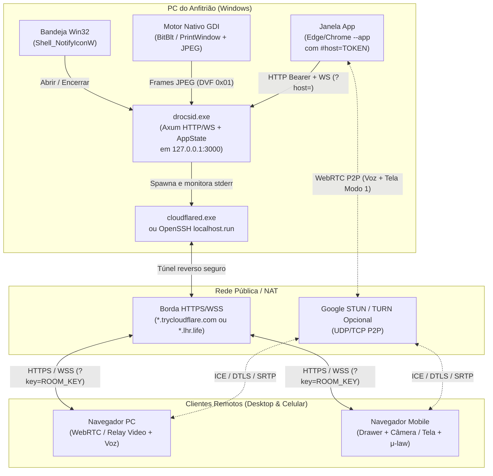
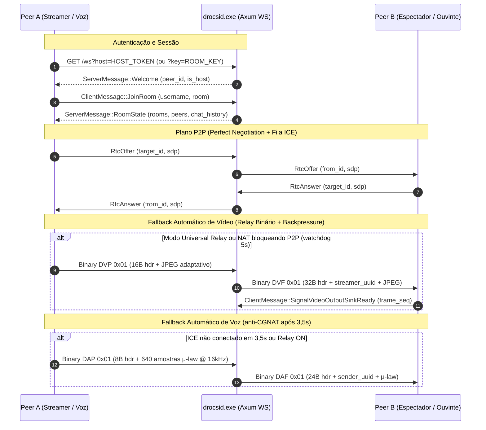
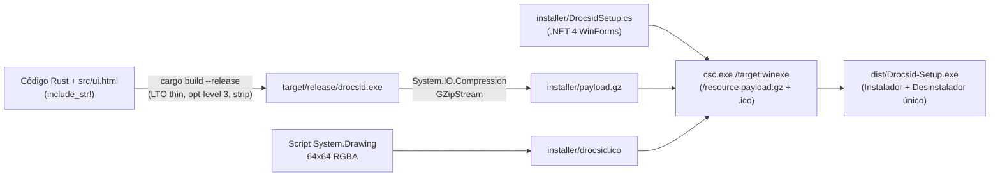

# Arquitetura e Processo de Construção do Drocsid (`v0.3.0`)

O **Drocsid** é uma plataforma auto-hospedada e leve para comunicação por voz, texto, webcam e compartilhamento de tela (*Go Live*), escrita em **Rust** com interface **HTML/CSS/JS embutida em um único executável nativo para Windows** e sem dependência de servidores centrais proprietários.

> [!NOTE]
> Este documento reflete a base de código implementada em `v0.3.0` (incluindo o suporte responsivo para navegadores em PC e celular, persistência de segredos e Relay automático de voz), com links diretos para os arquivos do repositório. Para diretrizes de colaboração de agentes de IA (autorização prévia, não regressão e sincronização de `todo`, `ARCHITECTURE.md` e `README.md`), veja [`AGENTS.md`](AGENTS.md).

---

## 1. Origem e Premissa Arquitetural (Engenharia Reversa com REA)

A arquitetura do Drocsid nasceu da análise estática de engenharia reversa (**REA**, `morluto/rea`) sobre o cliente desktop do Discord (`app-1.0.9267`), espelhando em Rust + Web APIs os principais mecanismos encontrados no módulo nativo e no bundle Electron ([`src/capture.rs`](src/capture.rs#L769-L772), [`README.md`](README.md#L58-L66)):

| Mecanismo Original (Discord `app-1.0.9267`) | Referência REA Observada | Equivalente no Drocsid |
|---|---|---|
| Listagem e miniaturas de monitores/janelas | `GetScreenPreviews` (ordinal `121` em `discord_voice.node`) e `getDesktopCaptureSources` (módulo webpack `9425` em `core.asar`) | `get_screen_previews()` + `GET /api/screens` ([`src/capture.rs`](src/capture.rs#L772-L817)) |
| Seleção da fonte de captura nativa | `SetDesktopSource` (ordinal `165`) / `SetGoLiveDevices` (ordinal `175`) | `ClientMessage::StartScreenShare` + `capture_source_jpeg_bytes` ([`src/protocol.rs`](src/protocol.rs)) |
| Sincronização de renderização (*backpressure*) | `SetVideoOutputSink` (`231`) e `SignalVideoOutputSinkReady` (`237`) | `SignalVideoOutputSinkReady` + janela deslizante `MAX_FRAMES_IN_FLIGHT = 2` ([`src/state.rs`](src/state.rs)) |

Diferente do Electron com múltiplas bibliotecas, o Drocsid concentra tudo em **um binário Rust único** (`drocsid.exe`) que atua simultaneamente como servidor HTTP/WebSocket local, servidor de sinalização WebRTC, relay binário anti-CGNAT, motor nativo de captura Win32 GDI e orquestrador de túnel público.

---

## 2. Topologia e Visão Geral do Sistema

Abaixo está a topologia de execução em tempo real quando o anfitrião (*Host*) abre o aplicativo e compartilha uma sala com amigos em outras redes (PC ou celular):

### Pilha Tecnológica ([`Cargo.toml`](Cargo.toml))

- **Runtime & HTTP/WS:** `tokio 1.40` (`full`), `axum 0.7` (com feature `ws`), `futures-util 0.3`.
- **Serialização & Identidade:** `serde 1.0`, `serde_json 1.0`, `uuid 1.10` (`v4`, `serde`), `base64 0.22`.
- **Codificação de Imagem:** `jpeg-encoder 0.6` (sem dependências C externas para compressão JPEG nativa).
- **Observabilidade:** `tracing 0.1` e `tracing-subscriber 0.3` (`env-filter`) gravando em arquivo com rotação.
- **Win32 Nível Sistema:** FFI direto contra `kernel32`, `user32`, `gdi32` e `shell32` (zero crates pesadas de GUI ou captura).
- **Empacotamento Windows:** PowerShell + .NET Framework `csc.exe` (`v4.0.30319`) gerando instalador WinForms autônomo ([`build-installer.ps1`](build-installer.ps1)).

---

## 3. Anatomia dos Módulos Rust (`src/`)

A biblioteca e o executável estão organizados de forma modular em [`src/lib.rs`](src/lib.rs):

| Arquivo | Responsabilidade Principal |
|---|---|
| [`src/main.rs`](src/main.rs#L1-L217) | Ponto de entrada (`windows_subsystem = "windows"` em release), parsing de CLI (`--headless`/`--server`, `--tunnel`, `--lan`, `--port`/`-p`, `drocsid://...`), diretório `%LOCALAPPDATA%\Programs\Drocsid`, rotação de log (`drocsid.log` > 5 MB), instância única via `session.url` + `/api/whoami`, abertura do Edge/Chrome em `--app` com perfil dedicado e loop `axum::serve`. |
| [`src/server.rs`](src/server.rs#L1-L706) | Roteador HTTP (`build_router`), SPA embarcada via `include_str!("ui.html")`, endpoints protegidos por `Bearer` (`host_token`), validação de `room_key` antes do upgrade WebSocket (`GET /ws`), canais limitados (`mpsc::channel(256)`), `max_message_size(2 MiB)`, rate limiting de chat (`150 ms`) e soundboard (`500 ms`), e moderação (`KickPeer`). |
| [`src/state.rs`](src/state.rs) | Estado global compartilhado (`AppState`): mapa de `peers` conectados, lista dinâmica de salas (`geral`, `jogos`, `cinema-tela`; máx. `MAX_ROOMS = 32`), histórico persistido em `chat_history.json` (máx. 150 msgs/sala), desambiguação de apelidos (`nome#xxxx`), backpressure de frames por espectador (`MAX_FRAMES_IN_FLIGHT = 2`, `FRAME_ACK_TIMEOUT_MS = 600`), relay binário de áudio/vídeo e loop assíncrono do motor nativo. |
| [`src/protocol.rs`](src/protocol.rs#L1-L442) | Contrato JSON (`ClientMessage`, `ServerMessage`, `ScreenShareMode`, `PeerInfo`, `ChatEntry`, `DesktopSourcePreview`) e codecs binários zero-base64 para vídeo (`DVP\x01`, `DVF\x01`) e voz (`DAP\x01`, `DAF\x01`). |
| [`src/capture.rs`](src/capture.rs#L1-L817) | Captura nativa Windows via GDI puro: `SetProcessDPIAware()`, cache de monitores (TTL 3 s via `EnumDisplayMonitors`), captura escalada `BitBlt` + `StretchBlt(HALFTONE)`, desenho de cursor real (`GetCursorInfo` + `DrawIconEx`), enumeração de até 8 janelas visíveis (`EnumWindows`) e captura de janela via `PrintWindow(..., PW_RENDERFULLCONTENT)` com fallback `BitBlt`, reutilizando buffers `thread_local!` (`BGRA_BUF`, `RGB_BUF`). Inclui stub procedural para alvos não-Windows. |
| [`src/tunnel.rs`](src/tunnel.rs) | `TunnelManager`: gerencia túnel público HTTPS/WSS. Procura `cloudflared.exe` localmente (ou baixa do GitHub verificando tamanho > 5 MB e cabeçalho PE `MZ`), executa com `CREATE_NO_WINDOW` e `kill_on_drop(true)`, drena `stderr` continuamente para detectar quedas inesperadas e faz fallback para OpenSSH (`nokey@localhost.run` com `-T -o BatchMode=yes` e timeout de 15 s). |
| [`src/security.rs`](src/security.rs) | Controle de papéis (`Role::Host`, `Role::Guest`), `Secrets` persistido em `secrets.json` (`host_token` de 64 hex chars e `room_key` de 32 hex chars protegida por `RwLock`), rotação dinâmica da chave da sala (`rotate_room_key`) e comparação em tempo constante (`constant_time_eq`). |
| [`src/invite.rs`](src/invite.rs) | Geração e parser resiliente de convites no formato URL (`https://host/#key=...`) e códigos curtos `DROCSID--<key>` (`*.trycloudflare.com`) ou `LHR--<key>` (`*.lhr.life`), mesmo colados dentro de frases. |
| [`src/tray.rs`](src/tray.rs) | Ícone nativo na bandeja do sistema Windows (`Shell_NotifyIconW`, `CreatePopupMenu`, `TrackPopupMenu`) usando `drocsid.ico` ou fallback `IDI_APPLICATION`, permitindo reabrir a janela com um clique ou encerrar limpo servidor + túnel (`Encerrar Drocsid`). |

---

## 4. Arquitetura do Front-end Embutido ([`src/ui.html`](src/ui.html#L1-L4096))

Toda a interface de usuário reside em um único SPA (4.096 linhas) incorporado em tempo de compilação no binário via `include_str!("ui.html")` ([`src/server.rs`](src/server.rs)), eliminando problemas de *asset path* ou servidores estáticos separados.

### Layout Responsivo (Desktop & Celular)
- **Desktop:** layout em 2 colunas com barra lateral (`#sidebar` contendo Túnel, Salas e Participantes + controles locais de Voz/Tela/Câmera/Soundboard/Áudio) e área principal (`#mainArea`) dividida verticalmente entre Palco de Vídeo e Chat via divisor arrastável (`#stageResizer`) ou **Modo Teatro** (`🎭 Teatro`) e **Picture-in-Picture**.
- **Mobile (`@media (max-width: 900px)`):** definido em [`src/ui.html#L908-L980`](src/ui.html#L908-L980), transforma a barra lateral em gaveta *off-canvas* (`#sidebar.open`), adiciona alternador de foco (`📐 Dividido`, `🎬 Palco`, `💬 Chat`), barra inferior fixa de acesso rápido e seletor de fonte no navegador (`#selectCaptureSource`: tela/aba via `getDisplayMedia`, câmera traseira `environment` ou frontal `user`).
- **Autoplay e Desbloqueio de Som:** tanto WebRTC quanto Web Audio tratam políticas estritas de navegadores exibindo o banner `#btnUnlockAudio` (`🔊 Ativar Som`) no topo global de `#mainArea` sempre que `play()` falha ou o `AudioContext` inicia suspenso.

### Recursos Interativos da Sala
- **Modo Grade 2x2 (`toggleGridMode`):** exibe até 4 transmissões simultâneas em `#stageGrid`.
- **Ponteiro Laser (`toggleLaserMode`):** envia coordenadas normalizadas `(x, y)` via `ClientMessage::LaserPointer` / `ServerMessage::LaserPointer` exibidas sobre o palco.
- **Webcam em Strip (`#webcamStrip`):** separada da trilha de tela pelo `stream.id`, evitando que webcam e tela do mesmo usuário ou de dispositivos móveis/PC se sobrescrevam ([`src/ui.html#L3849-L3883`](src/ui.html#L3849-L3883)).
- **Chat Rico + Imagens:** sanitização HTML (`escapeHtml`), detecção automática de links (`linkifyText`), Markdown leve (`` `código` `` e `**negrito**`), e envio de prints por `Ctrl+V` recomprimidos no canvas com prefixo `[drocsid-img]` (limite de 200.000 chars no servidor).
- **Soundboard da Sala:** 4 efeitos sintetizados em tempo real via Web Audio (`party`, `alert`, `badum`, `horn`) com cooldown de 500 ms no servidor.

---

## 5. Protocolos de Rede e Pipelines de Mídia

O Drocsid implementa **um plano de controle único sobre WebSocket** (`JSON`) e **dois planos de mídia híbridos** (WebRTC P2P + Fallback Binário no WebSocket) para garantir que áudio e tela funcionem tanto em LAN/UPnP quanto atrás de CGNAT simétrico sem servidor TURN pago.

### 5.1 Os Três Modos de Compartilhamento de Tela (`Go Live`)

1. **Modo 1 — `web_rtc` (P2P / TURN):**
   - Captura via `getDisplayMedia` direto do navegador para todos os peers em malha WebRTC (`getRtcConfig` usa STUN do Google `stun.l.google.com:19302` / `stun1.l.google.com:19302` e servidor TURN opcional configurado pelo usuário).
   - Implementa *Perfect Negotiation* em `handleRtcOffer` / `handleRtcAnswer` ([`src/ui.html#L4002-L4050`](src/ui.html#L4002-L4050)): desempate `polite = String(myPeerId) < String(fromId)`, rollback em colisão, fila `pendingCandidates` antes do `remoteDescription` e fila `pendingRenegotiatePeers` caso uma oferta recebida tenha interrompido uma renegociação local.
   - Se `oniceconnectionstatechange` falhar ou o *watchdog* de 5 s detectar falha de ICE, `fallbackWebRtcToUniversalRelay()` remove apenas os *senders* de vídeo (preservando o áudio do sistema no WebRTC) e comuta automaticamente para o Modo 2 ([`src/ui.html#L3770-L3807`](src/ui.html#L3770-L3807)).

2. **Modo 2 — `universal_relay` (Relay Binário WebSocket para Todos):**
   - Um `<video playsinline>` oculto anexado ao DOM alimenta um `<canvas>` *offscreen* em `startUniversalRelayCaptureLoop` ([`src/ui.html#L3126-L3196`](src/ui.html#L3126-L3196)).
   - **Adaptação dinâmica:** mobile limita largura a `854 px`; se `ws.bufferedAmount > 128 KiB`, reduz qualidade JPEG de `0.68` para `0.48` e teto para `854 px`; acima de `320 KiB`, pula o quadro.
   - **Protocolo Binário de Vídeo ([`src/protocol.rs`](src/protocol.rs#L271-L332)):**
     - **Upload (`DVP\x01`, 16 bytes de cabeçalho):** `[0..4] = "DVP\x01"`, `[4..12] = frame_seq (u64 BE)`, `[12..14] = width (u16 BE)`, `[14..16] = height (u16 BE)`, seguido dos bytes JPEG brutos.
     - **Broadcast (`DVF\x01`, 32 bytes de cabeçalho):** `[0..4] = "DVF\x01"`, `[4..20] = streamer_uuid (16B)`, `[20..28] = frame_seq (u64 BE)`, `[28..30] = width (u16 BE)`, `[30..32] = height (u16 BE)`, seguido do JPEG.
   - **Backpressure por Espectador (`should_send_frame` em [`src/state.rs`](src/state.rs)):** o servidor rastreia `(sent_seq, ack_seq, last_sent_at)` por espectador. Após o 1º quadro, aguarda confirmação `SignalVideoOutputSinkReady` emitida pelo cliente após `requestAnimationFrame` (ou libera por timeout `FRAME_ACK_TIMEOUT_MS = 600` ms se não houver mais que `MAX_FRAMES_IN_FLIGHT = 2` quadros em voo), evitando congestionar conexões lentas.

3. **Modo 3 — `native_host` (Captura Win32 GDI Exclusiva do Anfitrião):**
   - Habilitado apenas quando `is_host` é verdadeiro e o usuário está na origem local (`!customServerOrigin`).
   - O loop `start_native_capture_loop` captura o monitor ou janela escolhida em Rust (`capture_source_jpeg_bytes`) no servidor e despacha pacotes `DVF\x01` diretamente aos espectadores com a mesma lógica de *backpressure*.

### 5.2 Pipeline Híbrido de Voz (WebRTC + Relay Binário `DAP\x01` / `DAF\x01`)

Para resolver cenários em que WebRTC estabelece apenas candidatos locais/STUN mas o tráfego UDP falha em CGNAT (permitindo sinalização e efeitos sonoros do navegador, mas não voz P2P), o Drocsid combina:

- **Caminho Primário P2P:** `getUserMedia` + `RTCPeerConnection` (com seleção de microfone/saída via `setSinkId`, controle individual de volume e *Push-to-Talk* com `Espaço`/`V`).
- **Caminho Automático via WebSocket (`shouldTransmitVoiceRelay` em [`src/ui.html#L1567-L1585`](src/ui.html#L1567-L1585)):**
  - Dispara automaticamente quando qualquer colega em voz não alcança ICE `connected`/`completed` dentro de `3,5 s`, quando o ICE entra em `failed`/`disconnected`, ou quando qualquer participante ativa o modo manual (`🌐 Relay: ON`, replicado pelo campo `voice_relay` em `PeerInfo`).
  - **Codificação no Emissor ([`src/ui.html#L2773-L2825`](src/ui.html#L2773-L2825)):** um `ScriptProcessorNode` reamostra o microfone para **16.000 Hz mono**, acumula blocos de **640 amostras (`40 ms`)**, aplica gate de voz (*VAD*: `rms > 0.0035 || isSpeaking` com *hangover* de `600 ms` e controle de congestionamento `ws.bufferedAmount <= 64 KiB`) e comprime em **G.711 μ-law** (`linearToMulaw`).
  - **Protocolo Binário de Áudio ([`src/protocol.rs`](src/protocol.rs#L334-L377)):**
    - **Upload (`DAP\x01`, 8 bytes de cabeçalho):** `"DAP\x01"` + `sample_rate (u32 BE, 8000..=48000)` + payload μ-law (máx. `MAX_BINARY_AUDIO_BYTES = 8192`).
    - **Broadcast (`DAF\x01`, 24 bytes de cabeçalho):** `"DAF\x01"` + `sender_uuid (16B)` + `sample_rate (u32 BE)` + payload μ-law.
  - **Reprodução no Receptor (`handleBinaryAudioFrame` em [`src/ui.html#L1623-L1688`](src/ui.html#L1623-L1688)):** decodifica via `MULAW_DECODE_TABLE` para `AudioBufferSourceNode` por participante com *jitter buffer* leve (`0.055 s`, reancorado acima de `0.35 s`) e evita áudio duplicado silenciando se já estiver recebendo áudio WebRTC P2P válido para aquele peer.
  - A lista de participantes exibe em tempo real o transporte ativo por colega (`P2P`, `Relay`, `NAT` ou `...`).

---

## 6. Modelo de Segurança, Autenticação e Persistência em Disco

### Papéis e Segredos ([`src/security.rs`](src/security.rs))
1. **`host_token` (64 caracteres hex):** concede papel `Role::Host`. Necessário em `Authorization: Bearer <token>` para rotas administrativas (`/api/screens`, `/api/tunnel/start`, `/api/tunnel/stop`, `/api/tunnel/status`, `/api/room/rotate-key`, `/api/shutdown`) e via `?host=` no WebSocket para habilitar `native_host` e `KickPeer`.
2. **`room_key` (32 caracteres hex em `Arc<RwLock<String>>`):** chave da sala exigida em `/ws?key=<room_key>` **antes mesmo do upgrade WebSocket** (`401 Unauthorized` caso ausente/inválida). Pode ser rotacionada dinamicamente pelo anfitrião via `POST /api/room/rotate-key`, invalidando convites anteriores.
3. **Comparação constante (`constant_time_eq`):** evita ataques de temporização na validação dos segredos.
4. **Exposição mínima na rede:** o servidor escuta apenas em `127.0.0.1` por padrão (exigindo flag `--lan` explícita para `0.0.0.0`).
5. **Isolamento de Origem Remota na UI:** quando o usuário entra na sala de outro amigo via `"Usar Código"` (`customServerOrigin !== null`), `applyRoleVisibility()` oculta controles exclusivos do anfitrião local (`btnHostTunnel`, `btnRotateKey`, `modeNativeCard`, `btnShutdownApp`) e redireciona todos os WebSockets e chamadas à origem remota correta.

### Arquivos Persistidos em `%LOCALAPPDATA%\Programs\Drocsid`

| Arquivo / Pasta | Origem | Finalidade |
|---|---|---|
| `secrets.json` | [`src/main.rs`](src/main.rs), [`src/security.rs`](src/security.rs) | Persiste `host_token` e `room_key` entre reinicializações para manter a janela local autorizada e convites estáveis até rotação manual. |
| `session.url` | [`src/main.rs`](src/main.rs), [`src/tray.rs`](src/tray.rs) | Armazena a URL autenticada da instância ativa (`http://127.0.0.1:<porta>/#host=<token>`). Se `drocsid.exe` for aberto novamente (ou clicado via `drocsid://...`), lê `session.url` ao detectar `AddrInUse` e apenas reabre a janela existente. |
| `chat_history.json` | [`src/state.rs`](src/state.rs) | Histórico persistido das salas (até 150 mensagens por sala). |
| `drocsid.log` / `drocsid.old.log` | [`src/main.rs`](src/main.rs) | Log detalhado do servidor em modo Release (`windows_subsystem`), rotacionado ao passar de 5 MB. |
| `cloudflared.exe` | [`src/tunnel.rs`](src/tunnel.rs) | Cache local do cliente de túnel Cloudflare quando não encontrado no `PATH`. |
| `drocsid.ico` | [`installer/DrocsidSetup.cs`](installer/DrocsidSetup.cs#L243-L258) | Ícone usado nos atalhos e carregado pela bandeja do sistema. |
| `WebProfile/` | [`src/main.rs`](src/main.rs#L191-L198) | Perfil isolado de Edge/Chrome (`--user-data-dir`) para preservar permissões de microfone/câmera/tela entre sessões. |

---

## 7. Processo de Construção, Empacotamento e Instalação

O repositório versiona o código-fonte, `Cargo.lock` e o instalador pronto em `dist/Drocsid-Setup.exe` ([`.gitignore`](.gitignore#L1-L2) ignora `/target` e `/installer/payload.gz`). A geração do executável final e do instalador Windows ocorre em dois estágios automatizados por [`build-installer.ps1`](build-installer.ps1) (ou via duplo clique em [`compilar-instalador.bat`](compilar-instalador.bat#L1-L11)):

### Etapas Detalhadas do Build
1. **Ajuste de `PATH` e Compilação Release:** [`build-installer.ps1`](build-installer.ps1) inclui `%USERPROFILE%\.cargo\bin` e `C:\msys64\ucrt64\bin` no `PATH` da sessão e executa `cargo build --release` usando o perfil otimizado de [`Cargo.toml`](Cargo.toml) (`opt-level = 3`, `lto = "thin"`, `codegen-units = 1`, `strip = true`).
2. **Compressão do Binário:** comprime `target\release\drocsid.exe` em `installer\payload.gz` usando `.NET GZipStream`.
3. **Geração de Ícone Nativo:** cria dinamicamente um ícone 64x64 (fundo `#5865F2` com letra `D`) em `installer\drocsid.ico` via `System.Drawing`.
4. **Compilação do Setup Autônomo (.NET):** invoca `C:\Windows\Microsoft.NET\Framework64\v4.0.30319\csc.exe` sobre [`installer/DrocsidSetup.cs`](installer/DrocsidSetup.cs#L1-L480) embutindo `Drocsid.exe.gz` e `Drocsid.ico` como recursos gerenciados dentro de `dist\Drocsid-Setup.exe`, removendo em seguida os temporários `payload.gz` e `drocsid.ico`.

### Ciclo de Vida do Instalador e Protocolo `drocsid://` ([`installer/DrocsidSetup.cs`](installer/DrocsidSetup.cs#L196-L479))
- **Instalação (sem necessidade de UAC/Admin):** encerra instâncias abertas de `drocsid`, descompacta `Drocsid.exe.gz` em `%LOCALAPPDATA%\Programs\Drocsid\drocsid.exe`, extrai `drocsid.ico`, copia o próprio setup como `Uninstall-Drocsid.exe`, cria atalhos `.lnk` via `WScript.Shell` e grava duas chaves em `HKEY_CURRENT_USER`:
  - `HKCU\Software\Microsoft\Windows\CurrentVersion\Uninstall\Drocsid` (entrada em *Programas e Recursos* do Windows).
  - `HKCU\Software\Classes\drocsid` (`shell\open\command` apontando para `"drocsid.exe" "%1"`), permitindo abrir links `drocsid://...` direto do navegador para a instância rodando.
- **Desinstalação (`--uninstall`):** remove atalhos e chaves do Registro, pergunta ao usuário se deseja apagar também `chat_history.json`, `drocsid.log` e `WebProfile`, e agenda via `cmd.exe /C timeout /t 2 /nobreak >nul` a autoexclusão do próprio `Uninstall-Drocsid.exe` (ou `rmdir /s /q` na pasta inteira).

---

## 8. Estratégia de Testes e Validação Automatizada

A qualidade da base é verificada em camadas compatíveis inclusive com ambientes sem acesso à criação de sockets locais:

| Camada | Comando | Cobertura Observada |
|---|---|---|
| **Testes Unitários (14)** | `cargo test --offline` | Roundtrip JSON/binário (`DVP\x01`, `DVF\x01`, `DAP\x01`, `DAF\x01`) e tags UI↔Rust em [`src/protocol.rs`](src/protocol.rs), parser de convites `cloudflare`/`lhr` em [`src/invite.rs`](src/invite.rs), autorização/constante-tempo/Bearer em [`src/security.rs`](src/security.rs), regras de *backpressure* e desambiguação `#xxxx` em [`src/state.rs`](src/state.rs). |
| **Rotas HTTP sem Socket (4)** | `cargo test --offline --test http_routes` | Rotas públicas (`GET /`, `GET /api/whoami`), bloqueio `401` em rotas exclusivas do host para convidados ou portadores apenas de `room_key`, liberação com `Bearer <host_token>`, e recusa de upgrade em `GET /ws` sem `room_key` válida via `tower::ServiceExt::oneshot` ([`tests/http_routes.rs`](tests/http_routes.rs#L1-L106)). |
| **WebSocket Ponta a Ponta (3)** | `cargo test --test ws_e2e -- --include-ignored` | Servidor real `TcpListener` + clientes `tokio-tungstenite` validando recusa sem chave, atribuição de papéis + chat broadcast e bloqueio de `native_host` por convidado ([`tests/ws_e2e.rs`](tests/ws_e2e.rs#L1-L97); marcados `#[ignore = "precisa de sockets locais"]`). |
| **Empacotamento Completo** | `.\compilar-instalador.bat` | Gera e valida o executável release e o instalador final `dist\Drocsid-Setup.exe`. |
